# 烟火人间 · 一条老街的十二时辰

> 2026「零杯」网页设计大赛 · 主题一「市井烟火 · 百味人间」

一条三百米的青石巷，从辰时蒸笼上气，到戌时夜市收摊。
作品用 WebGL 把这条街做成可以走进去的第一人称空间：天色会变，灯笼会亮，摊子会冒汽，路上有人、有猫、有麻雀。
走一圈下来，浏览器里会留下一本只属于今天的**手账**。

> 校对说明：本文的数字与按钮名（断点、首屏与整包体积、加载顺序、菜单页数量、动作条数、各店弹窗按钮与分支）已按 `index.html` 与 `js/` 当前代码核对；标为「未生效 / 未接 / 待修 / 走不到」的，是代码里确实还没做、或已写了但当前触发不到的部分。

---

## 零、参赛信息

| 项目   | 内容               |
| ---- | ---------------- |
| 队伍名  | 关东组              |
| 队长   | 七公子™              |
| 组别   | 零组               |
| 队员   | 七公子™、xixi、月见草、CITY吖  |
| 参赛主题 | 主题一「市井烟火 · 百味人间」 |


---

## 一、怎么看

**方式一（推荐）**

1. 双击 `start.cmd`
2. 浏览器自动打开 `http://127.0.0.1:8756/`
3. 点「推门 · 入街」

**方式二**

```bash
node serve.mjs          # 或 PORT=8080 node serve.mjs
```

> 必须经本地服务器访问：页面用 ES Module 加载三维场景，`file://` 协议会被浏览器拦截。
> 服务器是零依赖的 Node 脚本，只监听 `127.0.0.1`，不联网、不上传任何数据。
> 真直接双击了 `index.html` 也不会一头雾水：页面会先铺一张说明纸，告诉你改从 `start.cmd` 进。
> `start.cmd` 会自己找 Node（PATH / `%ProgramFiles%\nodejs` / `%LOCALAPPDATA%\Programs\nodejs` / `E:\Node.js`），重复双击也不会报 `EADDRINUSE`——端口上已经有街，就直接把浏览器指过去。


**浏览器要求**：Chrome 129+ / Edge 129+（需支持 WebGL2 与 ES Module）。界面按 **1920 / 1440 / 720 / 390** 四种尺寸验收；CSS 里实际只有 **820px 与 640px** 两个主断点（另有 900、680 的局部规则），1440 与 1920 走流式布局，不另写一套。移动端用虚拟摇杆 + 底部导航。运行环境按手册要求为 **Chrome 129**，本地实测 Edge/Chrome 129 内核均正常。

---

## 二、能做什么

| 交互 | 操作 | 说明 |
| --- | --- | --- |
| 沿街漫步 | `W` / `S`、↑↓ 按钮、手机摇杆上下 | 第一人称前进后退，脚下有步速可调 |
| 左右挪步 | `A` / `D`、手机摇杆左右 | 在街道横向 **±3.5 米**内挪步（`lateralOffset`），不是转头 |
| 转视角 | 鼠标按住拖拽、点右下「转身」 | 拖拽改 `cameraYaw` / `pitch`（pitch 夹在 ±(π/2−0.1)）；**相机不会自动跟着街道弯**，转弯要自己转。手机在画面上左右拖会合成 `A`/`D`，实际也是横挪，当前不能拖屏转头 |
| 换时辰 | 顶部「清晨 / 正午 / 黄昏 / 入夜」 | 平滑过渡（`interpolateEnv()`，约 1 秒）到对应光照、天色、灯笼与市声 |
| 进店 | 点击任意店铺 | 纸片弹窗介绍这家店，主按钮按行当叫「查看菜单 / 看看价目 / 看看货 / 翻翻书目」，点进去是内景实拍、多帧灯箱或手写菜单页；打烊时段只留字条、不给按钮 |
| 读画 | 点击街两侧 / 身后的《千里江山图》 | 先是一句“战争还没有结束 · 点击继续”，接着进「2024 年高考语文考场」：竖版长图配四道填空题，交卷后按有没有留空给出满分 / 拒信两种结果；`Esc`、关闭钮或点空白处合上，手账记「做题」 |
| 点地 | 点击街面 / 石板路 | 落点冒出一张纸片小话：“地上没钱，别让钱迷了眼，忘了抬头看远山。”；地面会挡住后面的店铺与山水，不会穿透 |
| 进理发店 | 点理发店 →「进店看看」 | 铺一张店内实景照，师傅的话落在画面右上的墙上：“先找个位置坐，想剪个什么发型？”；仍可点「看看价目」看手写价目页 |
| 称肉 | 点卤肉铺 →「称一斤」 | 先给一张柜台实拍，3 秒后换到摊前那张，老板的话落在画面上：“今早现卤的，您想吃什么，自己挑。” |
| 挑果子 | 点鲜果铺 →「挑一袋」 | 一袋一袋挑，挑完过秤：秤盘落袋、指针偏、读数滚到总重总价，再盖一枚「称好了」 |
| 包点心 | 点糕点铺 →「包一盒」 | 柜台实拍铺满灯箱，画面上一句“好嘞，您看中哪样，我给您包上。” |
| 翻书目 | 点书店 →「翻翻书目」 | 一张店内实拍 + 一句“屋里安静，只有翻书的声音。”；点「进去看看」浮出诗集 / 轻小说 / 旧小说 / 长篇小说四本，点一本看一张书影 |
| 看看货（烟酒） | 点烟酒副食店 →「看看货」 | 两帧实拍：门口冰柜与柜台烟盒 → 老板把袋子推过来“少抽一口，少喝一杯，日子长着呢。”；弹窗里不摆「能便宜点吗」 |
| 掂一掂 | 点古玩店 →「掂一掂」 | 这家不摆「能便宜点吗」，只剩「看看货」+「掂一掂」并排；点了铺一张摊面实拍，旁边立一张「柜台上的字条」：“自己上手挑，凭眼力说话；看走眼不退货，顺走一件，十倍赔钱。” |
| 进店翻找 | 点杂货店 →「进店翻找」（原「称一包」） | 铺一张塞满旧物的柜台实拍，旁边立一张「老板的话」：“别看铺子小，麻雀虽小五脏俱全；您要什么，我这儿都翻得出来。”；手账记一笔「翻找」 |
| 翻一本 | 点书店 →「翻一本」 | 开卷照片铺满灯箱，上半幅压一段《务虚笔记》的句子；暗纱与柔焦向下羽化，跟照片咬在一起 |
| 点菜 | 内景点菜名 | 普通店弹一张菜图 + 名字，面馆是选面，杂货 / 理发只记一笔；价钱写在菜单行上，手账记「点了」，那一行冒一下热气 |
| 喝茶（中药铺） | 中药铺 →「老中医，来碗菊花茶！」 | 粗瓷碗里冲开干杭白菊，清苦裹着回甘；茶碗一浮出就记一笔「菊花茶」 |
| 茶馆看戏 | 点茶馆 →「沏一壶」 | 先黑屏旁白，再三张内景依次推近、茶客逐句说话，说完自动回街并把时辰切到夜里；手账记「喝了 · 茶馆里的一壶茶」 |
| 把脉 | 中药铺里「把脉」的问答 | 先一帧搭脉的手，再一句问诊，3 秒后浮出一张药方；药方不记手账 |
| 奶茶铺看价目 | 点奶茶店 →「菜单」 | 墙上那张手写价目表铺进灯箱，底下“价目都贴在墙上，凑近些看。” |
| 奶茶铺排队 | 点奶茶店 →「进店」（原「能便宜点吗」） | 柜台实拍铺满屏幕，店员那句话落在柜台右侧的排号板旁：“请稍作等待，前方有 4 杯正在制作中……”；4 秒后换成“终于轮到制作你点的奶茶了。”，再过 2 秒端出成品 |
| 摇柠檬水 | 点奶茶店 →「摇一杯柠檬水」→ 镜头落到门口那杯，按住上下摇 | 门口台阶上摆一只纸杯，杯身印着那只黄家伙（图案只占正面约 120°，其余留白），按住往上下一拖就是一捶，摇满 4 下柠檬捶开；手账记一笔「摇柠檬」，离街小票上多一行「摇过柠檬水」 |
| 手账 | 右侧「手账」钮 | 记录「吃了 / 喝了 / 遇见 / 路过 / 拍了」等；按自然日存进 `localStorage`，同一天刷新 / 关掉浏览器再打开都还在，跨天自动换新本，也可随时整本擦掉 |
| 拍照 | 先去照相馆借相机解锁，再点右侧相机钮 → 快门 / 空格 | 相机钮默认是锁着的（`body.photo-locked` 下直接隐藏）；解锁后隐藏全部界面，只留取景框，一键存成 PNG |
| 市声 | 右上「市声」钮 | 程序合成的街声：远处车流、夜里的虫鸣、偶尔一串车铃 |
| 搭话 | 点行人 / 橘猫 / 电线上的麻雀 | 冒出一句带方言味的短话，麻雀会被惊飞，过一会儿再落回来 |
| 今日到访 | 手账底部 | 「今日 N 人走过 · M 笔手账」——由本地 Node 后台统计 |
| 集烟火印 | 手账里六类各记一笔 | 吃了 / 喝了 / 遇见 / 路过 / 拍了 / 搭话 集齐，浮出「今日已圆满」，手账钮亮起一圈朱砂光（`body.all-seals`）；手账底部随时显示还差哪几枚，「搭话」＝走近摊子按 E 打字回车 |

---

## 三、技术上做了什么

**渲染层**

- three.js `0.160.0`，**全部依赖本地化**（`vendor/` 内含 three、GLTFLoader、DRACOLoader 与 draco 解码器），断网、慢网都能完整加载
- 街道由 `CatmullRomCurve3` 生成，店铺、行道树、路灯、电线杆按弧长参数化摆放；相机位置沿曲线行进，但**朝向不会自动随弯道转**，要靠拖拽或「转身」自己看
- 16 家店铺是 `.glb` 模型（DRACO 压缩），首屏按门面顺序加载进 `modelCache`，再用 `clone()` 复用几何与材质（不是运行时按需取用）
- 昼夜不是简单换天空盒：`currentEnv.night` 驱动主光、环境光、雾、灯笼自发光、店门暖光、摊位显隐

**程序化细节（本项目自研）**

- **行人**：胶囊体分段四肢 + 关节链（髋/膝、肩/肘），走路有摆臂、屈膝、身体前倾与上下起伏；站立时呼吸、换重心、转头；衣服/皮肤/裤子叠程序噪声贴图；脸有眼白、瞳孔、眉、鼻、嘴；32% 戴帽子
- **蒸汽**：三张程序生成的不规则汽团贴图轮换，每个摊子独立粒子池，仅相机 34m 内生成，边升边漂边放大边淡出
- **灯笼 / 暖光 / 猫 / 麻雀**：灯笼按夜色增强自发光并轻摆；麻雀在相机靠近 5.5m 时惊飞，9–18 秒后飞回原位
- **市声**：WebAudio 实时合成——低通粉红噪声当远处车流，三角波做夜虫，随机铃声；昼夜另挂两条本地循环底噪（白日 / 夜市），清晨 05–12 点播一段背景乐，来源见第五节

**界面层**

- 宣纸 / 墨 / 朱砂配色，宋体与楷体竖排；时辰轴、街名牌、纸片弹窗、手账抽屉、印章落款均为手写 CSS，无 UI 框架
- 手账按**自然日**用 `localStorage` 持久化：恢复时只认当天的 `t` 时间戳，同一天刷新、关掉浏览器再打开都还在；跨天自动换一本新的。落款纸、离街小票、烟火印都从这一份恢复后的手账派生
- 拍照走 `canvas.toDataURL()`，带闪光与文件名时间戳；快门音效当前**没有接**（只做了闪光）
- 手机端：虚拟摇杆与拖屏都走 Pointer Events → 合成键盘事件（`A`/`D` 即横挪），布局重排、隐藏键盘提示

**后台（加分项）**

- `serve.mjs` 零依赖 Node 服务：静态资源 + 三个接口
  - `POST /api/visit` 到访计数
  - `POST /api/journal` 手账落盘（`data/journal.jsonl`）
  - `GET /api/stats` 返回当日与累计数据（`data/stats.json`）
- 前端静默降级：没起服务器时，手账仍然可用，只是不显示「今日到访」
- 后台只保存时间戳、类别与名称（`data/journal.jsonl` 的 `t` / `kind` / `name`，不含备注），用于「今日到访」计数，不承担手账恢复；完整的用户手账由浏览器 `localStorage` 按自然日恢复

---

## 四、目录结构

```
2026-零杯零组-关东组-市井烟火/
|-- index.html          页面骨架与三维主程序（顶部有结构说明，内联脚本分十节）
|-- README.md           本文件
|-- css/design.css      界面设计系统（宣纸/墨/朱砂）
|-- css/opening.css     开场卷轴：开机纸、进度条、收卷（可整块删除，回退说明在文件头）
|-- css/seals.css       六枚烟火印与「今日已圆满」纸卡
|-- js/alive.js         烟火气：行人、蒸汽、灯笼、猫、麻雀、市声
|-- js/ui.js            时辰牌、手账、拍照、摇杆、后台对接
|-- js/seals.js         六枚烟火印：集齐六类手账后解锁彩蛋
|-- js/opening.js       开场卷轴：进度条（带假卡顿）、等模型加载、收卷退场
|-- models/*.glb        19 个模型：16 家店铺与摊、2 棵行道树、1 只橘猫
|-- images/*            内景插画、菜品、街面贴图、长卷
|-- audio/              循环底噪 2 条 + 操作音效 6 个 + 清晨 BGM
|-- vendor/             three.js r160 + GLTFLoader + DRACOLoader + draco
|-- data/               运行后自动生成：stats.json、journal.jsonl
|-- serve.mjs           本地服务器 + 统计接口
`-- start.cmd           一键启动
```

- `index.html` 顶部的注释就是这份文件的地图：内联脚本按「3D 配置与初始化 → 模型加载 → 场景装饰 → 路灯与牌坊 → 时间与天气 → 移动控制 → 柠檬水 → 2D 交互 → 帮助与进店引导 → 烟火气接口与主循环」十节排开，每节都以一条分节注释开头，搜标题即可跳转。界面层、烟火气层、印章与开场卷轴分别在 `js/` 的四个模块里，通过 `window.__*` 取用主程序里的 scene / camera / shops。

---

## 五、第三方库与素材说明

| 名称 | 版本 | 用途 | 许可 |
| --- | --- | --- | --- |
| three.js | 0.160.0 | WebGL 渲染引擎 | MIT |
| Cat 模型 `models/cat.glb` | 8,936 面 | Polinket「Barn Cat」 | CC0 1.0 |
| GLTFLoader / DRACOLoader / BufferGeometryUtils | 随 three.js 0.160.0 | 加载 `.glb`、解压 Draco 几何 | MIT |
| draco_decoder | 随 three.js 0.160.0 | Draco 解码（WASM） | Apache-2.0 |
| `audio/loop/loop_street_day_45s.mp3` / `loop_night_market_45s.mp3` | 队内素材 | 白日 / 夜市循环底噪 | 队内使用 |
| `audio/sfx/sfx_*.mp3`（6 个） | 队内素材 | 包点心（碗碟抽屉）、收银、油锅、倒茶、琵琶、提示音 | 队内使用 |
| `audio/Moon in One's Cup 杯中明月.m4a` | HOYO-MiX《原神》原声 | 清晨 05:00–12:00 背景乐 | 仅用于非商业参赛展示，不作商用 |
| `models/*.glb`（店铺 16 + 行道树 2） | 项目初始素材包 | 街景、店铺与行道树 | 随素材包提供 |
| `images/dishes/mianguan-*.jpg` | 网络图库原图（摄图网 / 昵图网等） | 面馆菜品与小料大图 | 仅用于非商业参赛展示；原图未裁剪，水印保留 |
| `images/interior/*` 及 `images/dishes/*` 其余实拍图 | 网络图片素材 | 内景与店内实拍 | 仅用于非商业参赛展示 |
| `images/qianli-scroll.png` | 王希孟《千里江山图》 | 街两侧与序页背景 | 公有领域 |
| `images/qianli-text-long.png` | 孙甘露《千里江山图》节选 | 画卷里的竖版文字长卷 | 仅用于非商业参赛展示 |

- **未使用任何预设样式库**（无 Bootstrap / Tailwind / Element / VUE elements），全部样式为本项目手写 CSS
- 未加载任何外部字体、CDN、统计脚本或第三方图标库；图标均为内联 SVG
- 3D 店铺模型来自项目初始素材包，实拍图、音频与长卷来源见上表；行人、灯笼、蒸汽、猫、麻雀、界面与全部交互代码为本队实现，街声由 WebAudio 合成
- 面馆 13 张菜品图是本队自备的网络图库原图，按原样使用（保留水印、未作裁剪），仅用于本次非商业参赛展示；如权利人提出异议，赛后立即撤下

---

## 六、对应评分点

| 维度 | 本作品的落点 |
| --- | --- |
| 创意 | 「十二时辰 + 可走进去的老街 + 今日手账」：把主题做成一段可重游的时间，而不是一张长页面 |
| 功能丰富性 | 漫步 / 横挪 / 拖拽转视角 / 换时辰 / 进店 / 点菜 / 喝茶 / 把脉 / 搭话 / 拍照 / 市声 / 手账 / 移动端 / 到访统计 |
| 流畅与实用 | 单页无跳转，键鼠与触屏双套操作，加载有进度，失败有提示 |
| 内容充实 | 16 家店铺、42 个菜品与货品图（`DISH_IMAGES`）、12 句行人应答、四段时辰文案，街景与店内实拍两套叙事 |
| 整体风格 | 宣纸底、墨色字、朱砂点睛；竖排标题与印章，二维界面与三维街景同一套语汇 |
| 布局 | 明信片式封面 → 沉浸街道 → 右侧手账抽屉；1920/1440 走流式，820 与 640 两个断点重排 |
| 细节 | 灯笼摆幅、蒸汽旋角、行人换重心、按钮纸纹与压印、手账落款、快门闪光 |
| 素材 | 模型与插画统一手绘质感，程序化材质补齐近景 |
| 导航 | 单页场景内导航：点店即进、ESC 即退、手账随时可开，无死路 |
| 技术 | three.js + GLTF/DRACO + 程序化几何与材质 + WebAudio 合成 + Canvas 导出 + Node 接口 |
| 适配 | 桌面流式 + 820/640 两个断点 + 手机竖屏（摇杆、抽屉全宽、字号与触控区放大）；未做陀螺仪 |
| 数据后台 | 本地 Node 服务记录到访与手账，前端展示当日汇总 |

---

## 七、说明

- 作品为原创实现，未抄袭既有作品；所用第三方库与素材已在第五节列明
- 首次进入会加载约 **10.9 MB** 资源（three 与 addons 1.78 + 19 个 GLB 7.38 + 街面与山水贴图 1.19 + 页面与脚本 0.52），本地服务器下通常 1–2 秒；加载期间显示进度文字
- 若 WebGL 不可用或模型加载失败，页面会弹出提示条（#error-toast），不会出现无声空白

---

## 八、截图

| | |
| --- | --- |
| 开机：纸色遮罩与进度 | 第一次进街的提示 |
|  | 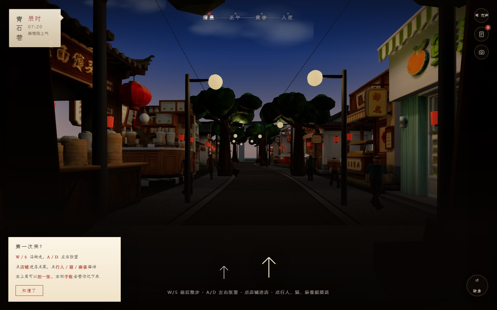 |
| 封面：竖排标题与印章 | 街景：时辰牌、街名牌、工具列 |
| 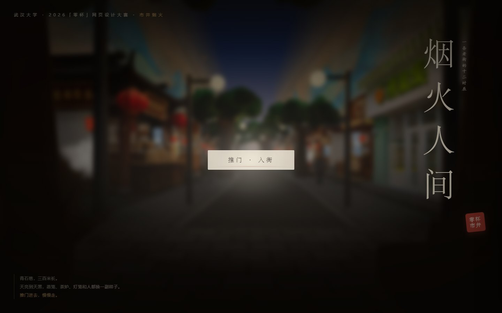 | 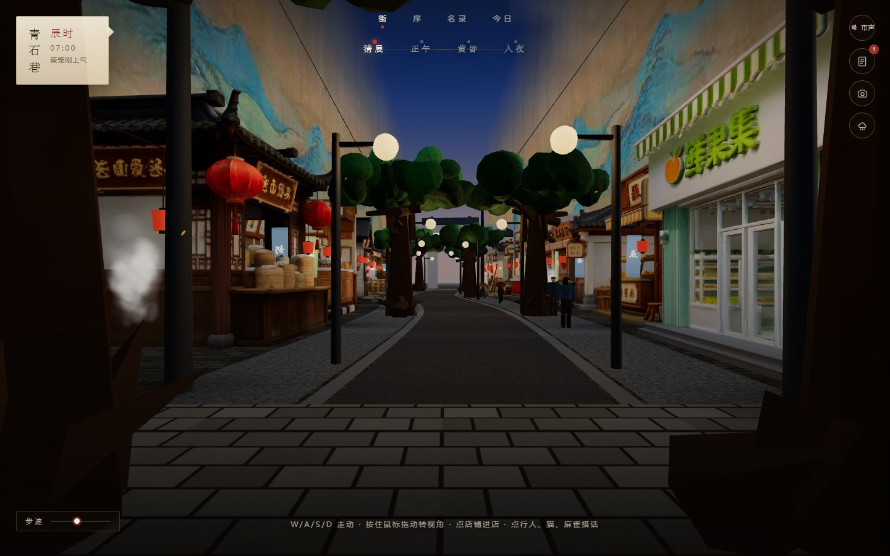 |
| 今日手账与到访统计 | 内景：手绘菜单 |
| 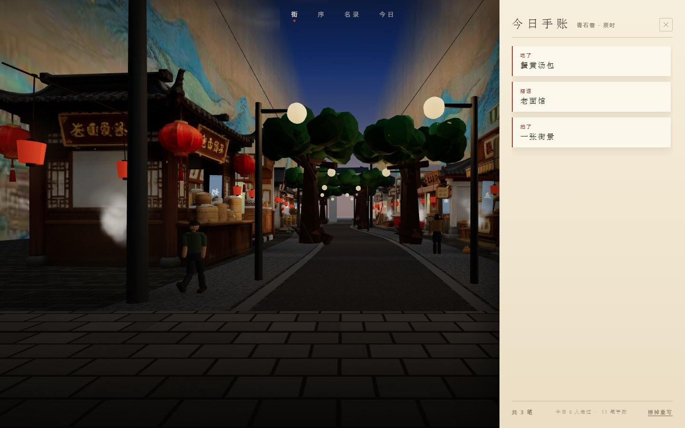 |  |
| 拍照模式 | 手机竖屏 |
| 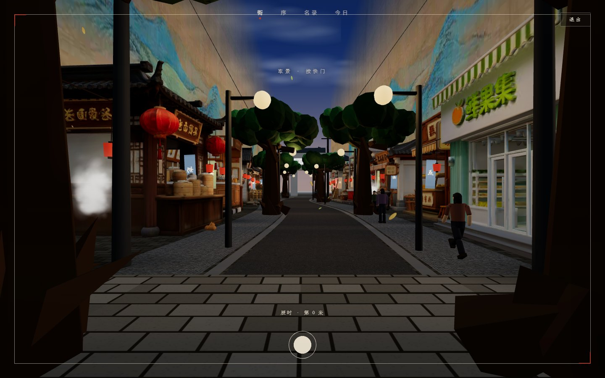 | 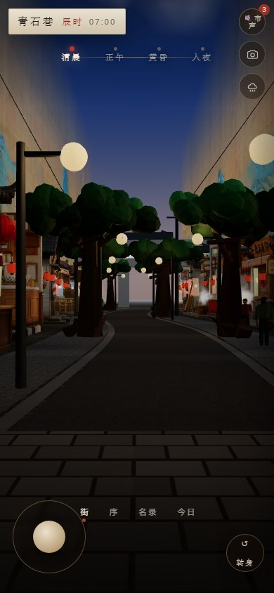 |
| 店铺弹窗：营业时间与招牌 | 平板 720×1280 |
| 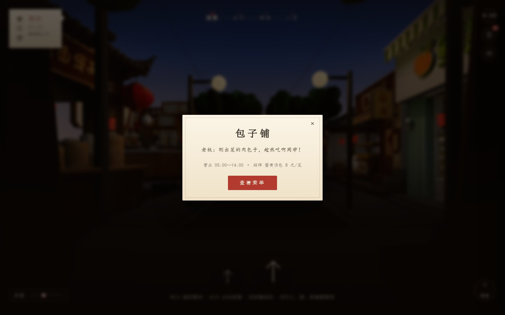 | 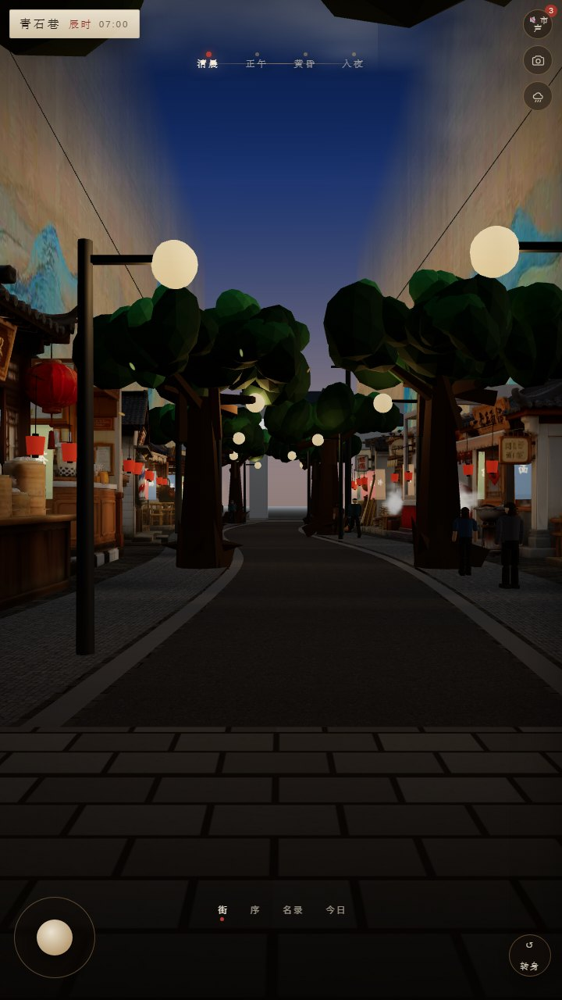 |
| 序：为什么做成可以走进去的街 | 名录：十六家店的招牌与作息 |
|  | 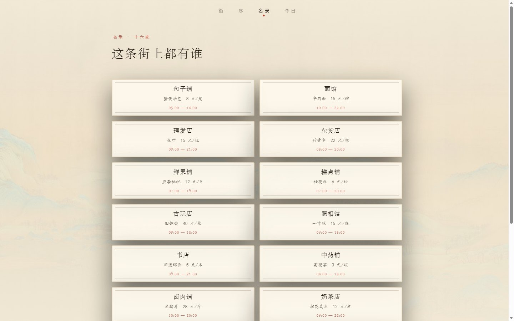 |
| 今日：手账与这一趟 | 打更：跟着亮点敲 |
| 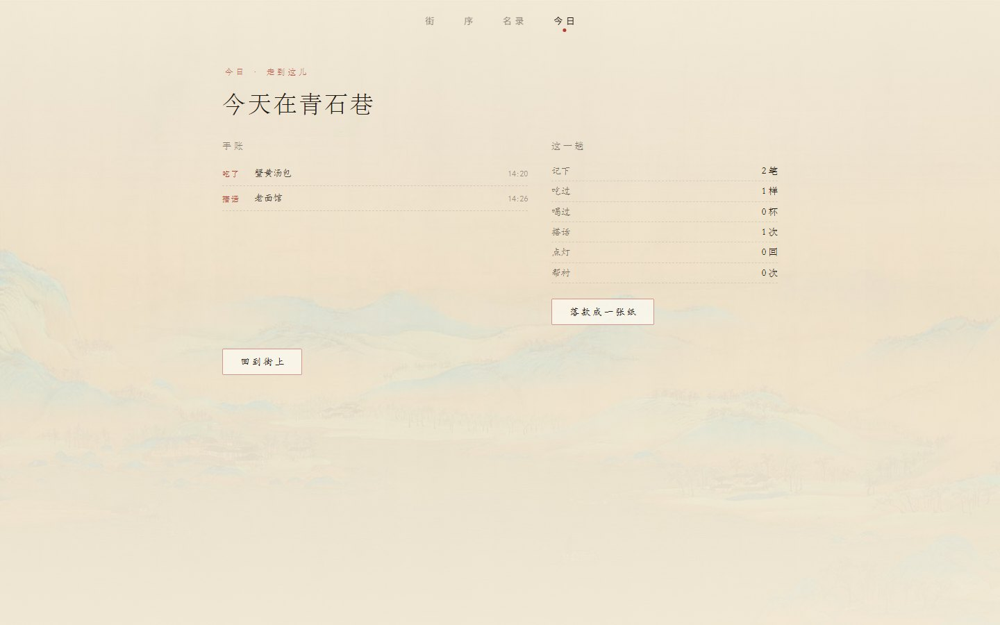 | 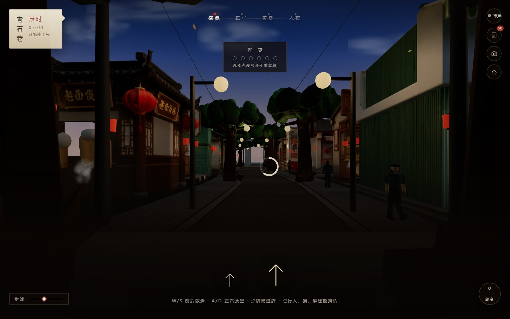 |
| 搭话：打字跟摊主聊 | 砍价：能便宜点吗 |
| 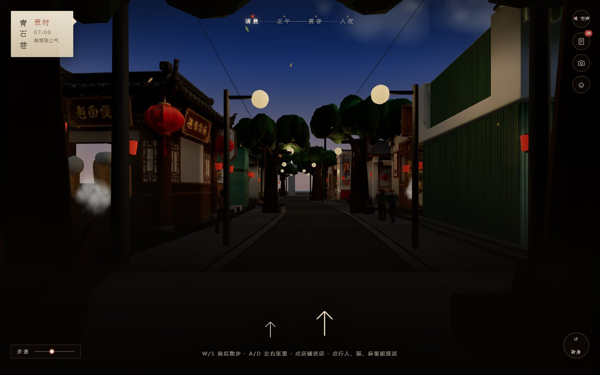 | 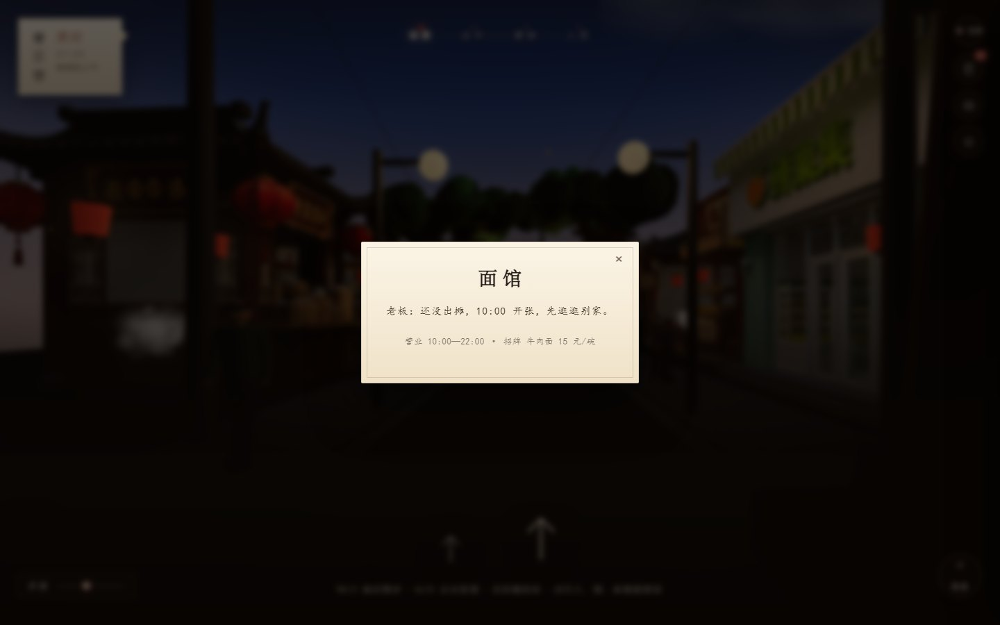 |
| 雨夜：伞、雨声、深巷 | 手写菜单页：按行当换措辞 |
| 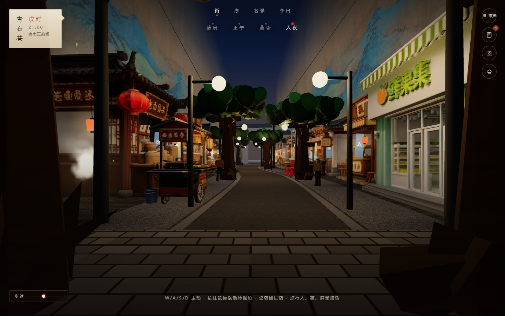 | 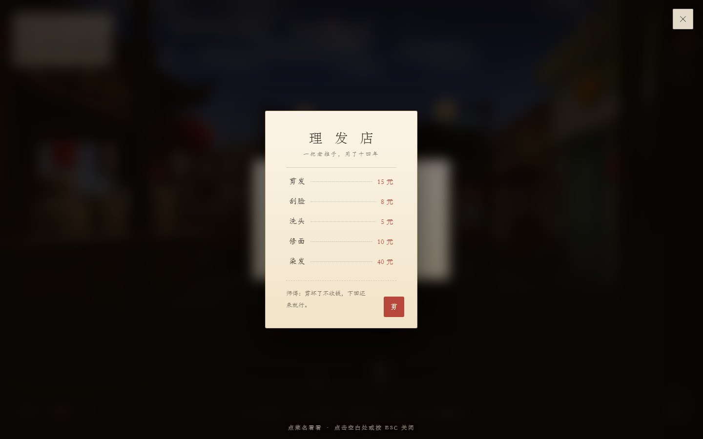 |

（截图目录：docs/，按 1440×900、1280×720、720×1280 与 390×844 采集）

---

## 九、这一版补的细节

- **开机**：纸色遮罩 + 朱砂印章 + 极细进度线，文案随进度换（扫街 → 挑灯笼 → 生炉子 → 摆摊）
- **首次进街**：只有第一次出现的小提示卡，讲清怎么走、怎么进店、去哪看手账，并补上 `E` 搭话 / `G` 打更 / 空格帮衬 / 长按撸猫；走近猫、夜市推车、奶茶店、包子铺与任意摊子时，左上角再递一张不写存储的操作小纸片
- **店铺**：每家写明营业时间与一道招牌菜；打烊时段门口只留一张字条（「这时候还没出摊，HH:00 开张。」／「今日已收摊，明早再来。」，开张时间按该店 `open` 生成），不出按钮、不让老板说话——只有营业中才进得了店、还得了价、搭得上手；没有内景的店不再给空按钮
- **手账**：落一条时右上角钮荡一圈朱砂涟漪
- **手账按天留存**：同一自然日刷新、重开浏览器都会把记录接回来；跨天自动换新本。页面加载时先把已有类别认成「已看过」，不会为旧手账重复弹印，也不会在开机时突然盖一张「今日已圆满」
- **街面**：二十六片落叶随风飘，靠近地面才淡出
- **声音**：进店时环境声压到 42%，进内景压到 22%，出来恢复
- **页面**：补了 description、主题色、modulepreload 与朱砂印章 favicon
- **菜单**：`MENU_PAGE` 里 **8 家**（面馆、糕点铺、奶茶店、杂货店、理发店、鲜果铺、卤肉铺、书店）走一张 HTML 手写页——菜单、价目、书目、货单各按本行措辞，右下印章随行当换字（尝/剪/读/杂/鉴），背景是虚化的街景；其余店走内景实拍或各自的专用流程
- **街边读画**：点街两侧或身后的《千里江山图》，先一句“战争还没有结束”，再进「2024 年高考语文考场」——`qianli-text-long.png` 竖版长图用滚轮 / 方向键 / PageUp·PageDown 翻，右侧答题卡有四道填空题，交卷后给「您已超越全国 98.5% 的高中生」或一封拒信；每次打开手账记「做题」
- **点地小话**：地面也参与射线遮挡，点街面不会穿透到后面的店铺或山水；落点会冒一张纸片气泡，3.8 秒后自己收走
- **面馆一碗粿条**：营业时间 **6:00—22:00**，开局就能进店；菜单页选一碗面、加小料 / 其他，按「下单 · N 元」进吃面场景（邻桌四句气泡、可回一句，手账记「吃了」）；店铺弹窗的「下一碗」只是把这张菜单打开，不直接记手账
- **理发店进店看看**：弹窗收敛成两个出口——「看看价目」看手写价目页，「进店看看」铺一张店内实景照片；师傅那句“先找个位置坐，想剪个什么发型？”用纸片气泡落在画面右上，窄屏时自动夹在画面内
- **卤肉铺称一斤**：点一下先看柜台（3 秒），再换到摊前那张，老板一句“今早现卤的，您想吃什么，自己挑。”用纸片气泡落在画面右上；灯箱现在支持多帧与图上落话
- **糕点铺包一盒**：灯箱换成柜台实拍，老板一句“好嘞，您看中哪样，我给您包上。”落在画面上方
- **鲜果铺挑一袋**：摊前实拍进灯箱，点水果放大后可「装进袋子」，挑完过秤、结账，手账记「买了」
- **书店翻书目**：这家不还价（`NO_BARGAIN_SHOPS`），弹窗主按钮是「翻翻书目」——先一张店内照 + “屋里安静，只有翻书的声音。”，点「进去看看」浮出诗集 / 轻小说 / 旧小说 / 长篇小说四本，点一本看书影；代码里留着的 `BARGAIN_MOMENTS['书店']`（旧书摊照 + 回绝）因按钮被隐藏而走不到
- **烟酒副食店看看货**：这家也没有价可讲——主按钮叫「看看货」，点了是两帧实拍：门口冰柜与柜台烟盒，随后老板把袋子推过来“少抽一口，少喝一杯，日子长着呢。”；`BARGAIN_MOMENTS['烟酒副食店']`（另起一张纸的劝）与「进店买两样」的按钮文案都还在，但按钮被 `NO_BARGAIN_SHOPS` 隐藏，当前走不到（待修）。原图右下角「装修123」logo 与中段平铺的 `zx123.cn` 淡字都用 `tools/despeckle-wm.ps1` 处理掉了（`tools/yanjiu-with-watermark.jpg` 是原件）
- **古玩店掂一掂**：这家连「能便宜点吗」都不摆（`NO_BARGAIN_SHOPS`），弹窗里只剩「看看货」+「掂一掂」两个并排、同高；点「掂一掂」是一张摊面实拍，旁边立一张纸，抬头写「柜台上的字条」而不是「老板的话」——“自己上手挑，凭眼力说话；看走眼不退货，顺走一件，十倍赔钱。” 用的是和烟酒副食店同一套 `.dish-note` 版式
- **书店翻一本**：开卷照片铺满灯箱，上半幅压史铁生《务虚笔记》的一段话。文字用宋体、两端对齐，背后是一层向下淡出并四边羽化的暗纱（`backdrop-filter` 做柔焦，放在伪元素里，所以字本身不发虚）；题记从图片上沿内缩 5%、左右各留 5.8% 摆，和照片上半部咬在一起
- **杂货店进店翻找**：「称一包」改叫「进店翻找」（点一下就出，不用长按），铺一张塞满旧物的柜台实拍，旁边立一张「老板的话」——“别看铺子小，麻雀虽小五脏俱全；您要什么，我这儿都翻得出来。”
- **进门这一步**：开机遮罩 `#boot` 改成不接点击（`pointer-events: none`），16 个模型还没加载完也不会挡住「推门 · 入街」；加载完自动从 DOM 里摘掉，另有 **20 秒**兜底（`setTimeout(..., 20000)`），模型卡住也不会把人锁在开机纸上
- **奶茶店三件事**：「菜单」铺墙上的手写价目表；「能便宜点吗」改叫「进店」，点下去是柜台实拍——先铺满屏幕排号（“请稍作等待，前方有 4 杯正在制作中……”落在柜台右侧的排号板旁），4 秒后换成“终于轮到制作你点的奶茶了。”，再过 2 秒端出成品并配一句“奶香先冒头，茶味随后到；吸管一插到底，珍珠还带着余温。”
- **门口那只柠檬水杯**：`buildLemonCup()` 现搭的纸杯——杯身、杯盖、盖沿、吸管、一片柠檬；杯身上那圈包装用 canvas 画，白底，图案只占正面约 120°，其余留白（卷满一圈就只能看见中间一条）。杯子的正面正对街心，站在街上抬眼就是图案；摆位会自动错开行道树（18 米起每 14 米一棵）与路灯（8 米起每 11 米一盏），免得从街心望过去正被树挡住。按住杯身往上下一拖就是一捶，摇满 4 下柠檬捶开，杯子弹一下、缩回去；提示条一路跟着报“还差几下”

---

## 十、能与这条街做什么

| 动作 | 位置 | 反馈 |
| --- | --- | --- |
| 走 | W/S、A/D 或左下摇杆 | 相机高度随脚步轻晃（`bobY`，±0.035 m），脚步有声；A/D 是横挪，不是转头 |
| 换时辰 | 顶部时辰轴，或什么都不点（时间会自己走，一天约 96 分钟） | 光、灯笼、摊位、市声一起变；行人按自己的路线走，落雨才撑伞 |
| 进店 | 点店铺 → 「查看菜单 / 看看价目 / 翻翻书目」等（按店铺而定） | 内景实拍或手写纸片单子；点菜名会记「点了」并冒热气 |
| 搭话 | 走近摊主，等吆喝，按 E | 摊主应一声，手账记「搭话」 |
| 帮衬 | 夜市推车旁，按空格 | 蒸汽冲上来、摊主道谢，翻够六串记「帮衬」 |
| 点灯 | 点灯笼（再点一次熄掉） | 檐下横杆挂着，点亮会亮、会照地，点满六盏有回应 |
| 招猫 | 点猫 | 猫跟你走一段，手账记「招呼」 |
| 落雨 | 右上角云雨钮 | 细雨、雨声、各地段的声场；行人撑伞、走得更急，灯笼暗一档，摊上的热气也淡下去 |
| 落款 | 街尾「落款今日」 | 把今天的手账画成一张纸，可保存 |
| 小结 | 攒够五件事 | 一张纸告诉你今天在这条街上做了什么 |
| 深夜 | 什么都不用做，等时间走到 23 点 | 夜市推车收进檐下，灯笼暗下去，街自己睡了 |

快捷键：`E` 搭话、`G` 打更、`空格` 帮衬 / 打更敲拍 / 拍照模式快门、`Esc` 退出内景与手账。

### 后来加的四种"不只是点一下"

| 动作 | 怎么做 | 反馈 |
| --- | --- | --- |
| 撸猫 | 在猫身上按住不放，直到圆环走满 | 猫在脚边打滚，手账记「顺毛」 |
| 搭话 | 走近摊主，按 `E` 打开输入框，打字回车 | 老板按你说的话答；问价、夸味道、道谢答案都不同 |
| 打更 | 按 `G` 起更，跟着亮起的格子敲空格 | 六更命中数记录在案，手账记「打更」 |
| 守蒸笼 | 在包子铺前站住不动约 25 秒 | 汽一阵阵紧，最后掀盖，「守候·等到第一笼」 |

### 又加的三样

| 动作 | 怎么做 | 反馈 |
| --- | --- | --- |
| 讨价还价 | 弹窗里点「能便宜点吗」 | 对没被 `NO_BARGAIN_SHOPS` 排除的店，有三种结果（抹零 / 多添一勺 / 街坊价），同一天同一家不重复让价；奶茶店的按钮改成「进店」，点了走排队过场。书店与烟酒副食店虽仍留着 `BARGAIN_MOMENTS`，但按钮已被 `NO_BARGAIN_SHOPS` 隐藏，当前走不到（待修） |
| 拍照评语 | 按快门存图后 | 数相机 **15 米内**站了几个人、看当前夜值是否过半（`critiqueShot()`），给一句短评 |
| 让路 | 走得太近，行人会停半步 | 侧过身说「您先过。」，十秒内不重复 |

---

## 十一、这一版的导航与加载

- **四个视图**：街（3D 场景）、序（设计说明）、名录（十六家店，点卡片直接回到街上并打开那家店）、今日（手账与统计，可落款成一张纸）。顶部一条极细的导航（窄屏挪到底部），当前项用朱砂点标出。
- **切视图不浪费功耗**：离开街道时 `window.setStreetPaused(true)`，`animate()` 直接返回，WebGL 不再重绘；回到街上恢复。
- **分级加载**：第一级按门面顺序、并发 3 个加载，`DAY_NAMES` 实际包含全部 **16 家**（含炸串摊、烧烤车），全部完成后才建街、进封面；`scheduleNightLoad()` 再在 `requestIdleCallback` 里按 `NIGHT_NAMES` 补一次。注意：两个推车因此会请求两遍，属于已知的重复加载，后续应从第一级里剔掉。
- **三层声音**：环境底噪（分区变频率）、脚步声（每走一米九落一下）与碗碟（点菜、挑果、加小料时），全部 WebAudio 现场合成，不占资源体积。门轴音色 `creak()` 已经写好，但当前没有调用点。

---

## 十二、与队友版本合并的部分

- **环境声**：三个按时辰切换的环境声段——清晨 05:00–12:00 放《杯中明月》背景乐，12:00–17:30 白天街市循环，17:30 之后夜市循环（`bedForHour()` 选段；换段时旧段以 0.6、新段以 0.9 的 `setTargetAtTime` 时间常数交叉淡入淡出）；非清晨时段每隔 12–26 秒随机撒一声油锅 / 收银 / 提示音 / 琵琶，进店、落雨时会自动让位
- **门口招呼**：十六家各有一句自己的吆喝，走近才喊，只喊最近的一家，画面外的店不喊
- **拍立得**：拍照存下来的不是裸截图，是一张相纸——米黄纸边、旧纸斑点、日期与「烟火人间 · 青石巷」落款、右下朱砂「烟」印
- **茶馆的戏**：点茶馆「沏一壶」→ 黑屏旁白三段，然后三张内景依次推近，茶客逐句说话（气泡按图上的位置摆），说完自动回街并把时辰切到夜里
- **回头也有街**：进街后转身，迎面是一座雾里的远山（z=124 处的封口面），不再是一块虚空
- **两侧山水**：街道左右各立一整幅《千里江山图》（`PlaneGeometry(470, 156)`，立在 x=±34、y=38、z=−55，用 alphaMap 往上淡出），从街心看，两侧是直上天际的山，头顶只留一道天光
- **序页背景**：铺了王希孟《千里江山图》的局部（该图来自队友素材，公有领域），上面压一层纸色，字仍清楚；「名录」和「今日」两页也铺同一张山水，只是位置更低，字都压在纸上；点页面底部的注，能把全卷拉出来看（拖拽横向移动，Esc 或「合上」关闭）
- **快门反馈**：按快门有一下闪光（`flash()` 插入 `#flash` 播 `flashGo`）；快门音效目前**还没接**，`takeShot()` 里没有 `oneShot` 调用，属于待补项
- **离街小票**：街尾可以领一张小票，写着吃了几样、说了几句话、拍了几张、走了多少米，右下朱砂「来过」，可存图
- **搭把手**：奶茶店「摇一杯柠檬水」、卤肉铺「称一斤」各有一句回应和一声近场音；包子铺**没有动作按钮**，在门口站住约 25 秒会自动掀盖（`trackWait()`），记一笔「守候」

---

## 十三、按队友待办清单对齐的部分

| 项           | 状态  | 说明                                                                       |
| ----------- | --- | ------------------------------------------------------------------------ |
| A1 照相馆拍照    | 有   | 取景框、闪光、相纸白边与朱砂印；相纸脚下印「日期时间 · 第 N 米」；点「租借相机」先看相机图、再确认解锁，解锁后相机钮才出现；`?shop=照相馆` 深链因 `photoUnlocked` 每次加载都重置，当前不会触发（可视为待修） |
| A2 离街小票     | 有   | 街尾「领一张离街小票」，锯齿撕口、按类计数、走过多少米，末尾一句「今天走到头了，明天还来吗？」                          |
| A6 打包与体积    | 部分  | 不换模型，首屏约 **10.9 MB**、整包实测 **39.51 MB**、全站零外链；店铺模型已经是 Draco（`cat.glb` 未压），下一步是图片统一 webp/avif 并按需加载、模型贴图换 KTX2，而不是再压一遍 Draco |
| B1-补 奶茶三杯上限 | 未生效 | 提示文案与按钮逻辑还在（`MILK.tip` / `MILK.say`），但常量是 `MILK.max = Infinity`，当前不会真正拦第四杯；要启用得把 `max` 改成 3 |
| B5 门口招呼气泡   | 有   | 十六家各一句，进门 6 米、出门 6.4 米迟滞，只招呼最近且门楣在画面里的一家                                 |
| __B1 一键动作手感 | 有   | 10 家有动作按钮的店都点一下即出（`moment` / `cup` / `fruit` / `tea` / `unlock` / `noodle` 分支），另保留按住 520ms 的兼容路径；按住有缩放与光晕，触发时卡片轻震、配各自音效与手账记录；`SHOP_ACTIONS` 共 11 条，理发店的动作按钮被 `VISIT_ONLY_SHOPS` 隐藏 |
